# Flujo de pagos de MOVO

Cómo circula el dinero de un envío, desde que el transportista vincula su cuenta de
Mercado Pago hasta que cobra. Refleja el diseño vigente al **29/09/2026**, después del
spike MOVO-49 y del rediseño de los tickets de pago en Linear (etiqueta **Pago**).

- Evidencia técnica del spike (requests reales, cuentas de sandbox, SDK vs API):
  `docs/payments/mercadopago-spike/SOLUCION-FINAL.md`.
- Estados del envío: `docs/shipments/state-diagram.md` (el código manda:
  `services/movo-svc-shipments/src/domain/shipment-state-machine.ts`).

Si el diseño cambia, se actualiza este documento en el mismo PR que el cambio.

---

## 1. Resumen en cinco líneas

1. El **transportista** vincula su cuenta de Mercado Pago a Movo (OAuth). Sin eso no puede ofertar.
2. Cuando el **emisor** acepta una oferta, paga con una **tarjeta guardada** escribiendo solo el CVV (DD-039, propuesto). No se le cobra:
   se le **reserva** el monto (hold, `capture: false`).
3. La reserva se crea **cerca del retiro**, porque MP la cancela sola a los pocos días.
   Si el retiro está lejos, el emisor confirma el pago cuando se acerca la fecha.
4. Cuando el paquete se **entrega** (handshake), Movo **captura** el hold. MP reparte el
   dinero en el mismo momento: la comisión va a Movo y el resto al transportista (split).
5. Si algo falla antes del retiro, el envío vuelve a publicarse. Si falla después de la
   entrega, se reintenta y, si no alcanza, se escala a revisión manual.

---

## 2. Componentes y responsabilidades

| Componente | Qué hace en el flujo de pagos |
| --- | --- |
| `movo-mobile` | Vincula la cuenta de MP del transportista (navegador embebido). Muestra el formulario de tarjeta de MP y tokeniza en el dispositivo. Muestra el estado de la reserva y el detalle del cobro. |
| `gateway` | Punto de entrada único. Expone `/shipments/*` y `/payments/*` (OAuth y consultas), más dos rutas públicas: el callback de OAuth y el webhook de MP. |
| `movo-svc-shipments` | **Dueño de la saga.** Decide la ruta (cercana o lejana), transiciona estados, corre los jobs de vencimiento y es la única puerta del mobile para pagar un envío (`/shipments/:id/funding`). Llama a `svc-payments` por endpoints internos. |
| `movo-svc-payments` | **Único que habla con Mercado Pago.** Guarda los tokens OAuth de cada transportista. Crea, consulta, libera y captura holds. Persiste holds y liquidaciones, y recibe los webhooks de MP. |
| Mercado Pago | Procesa la tarjeta, retiene los fondos y, al capturar, reparte entre Movo (`application_fee`) y el transportista. |

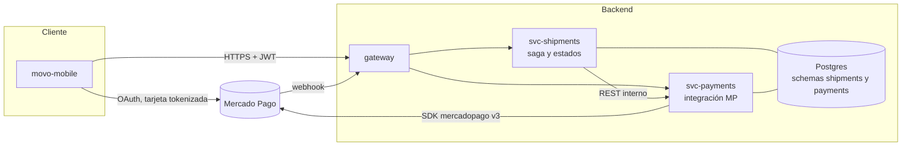

---

## 3. Proceso general

Vista de punta a punta del ciclo de vida del pago de un envío, con los caminos de fallo.

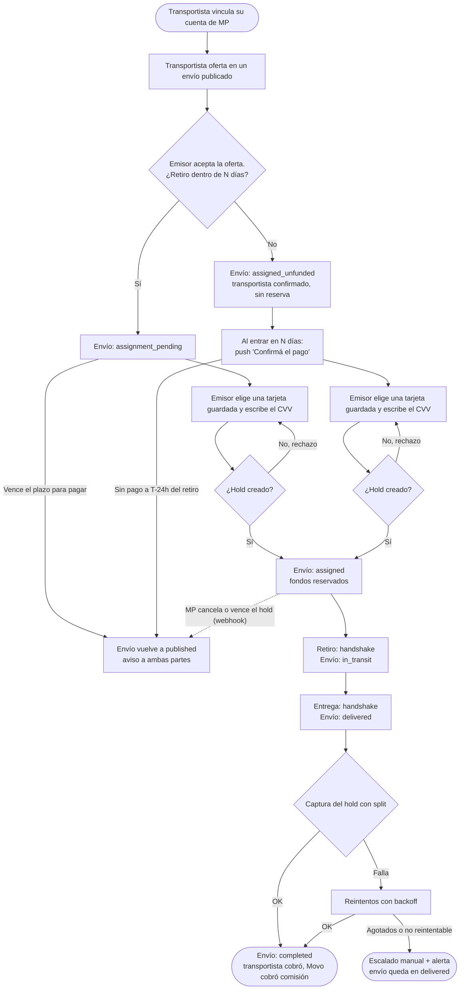

Reglas que el diagrama no muestra explícitamente:

- **Un envío en `assigned_unfunded` nunca puede iniciar el retiro.** La máquina de
  estados rechaza `assigned_unfunded → in_transit`.
- **La entrega no se revierte.** Si la captura falla, el envío se queda en `delivered`:
  el handshake es un evento inmutable.
- **Un hold en `assignment_pending` solo existe por una falla a mitad de camino.** En el
  camino normal, crear el hold pasa el envío a `assigned` en el mismo paso (secuencia
  5.2). Si MP autoriza pero la transición en `svc-shipments` falla (caída, timeout o
  conflicto de concurrencia), queda un hold creado con el envío todavía en
  `assignment_pending`. Ese es el caso de compensación que tienen que cubrir MOVO-209/210
  (cómo se resuelve, reintentar la transición o liberar el hold, se define ahí). Si en
  ese estado el emisor cancela, el hold se **libera**.
- **Cancelar desde `assigned` (MOVO-307, DD-047):** con 12 h o más hasta el retiro, o con
  la ventana ya cerrada, es sin cargo y se libera el hold. Con menos de 12 h se cobra el 25 %
  del precio acordado capturando esa parte del hold (MOVO-306); MP libera el resto. Si la
  penalidad no cubre la comisión del hold más el fee de MP, se libera entero y queda como deuda del emisor
  en su cuenta corriente (DD-044).

---

## 4. Estados del envío que toca el pago

Subconjunto del DTE completo, solo con las transiciones que dispara el flujo de pagos.

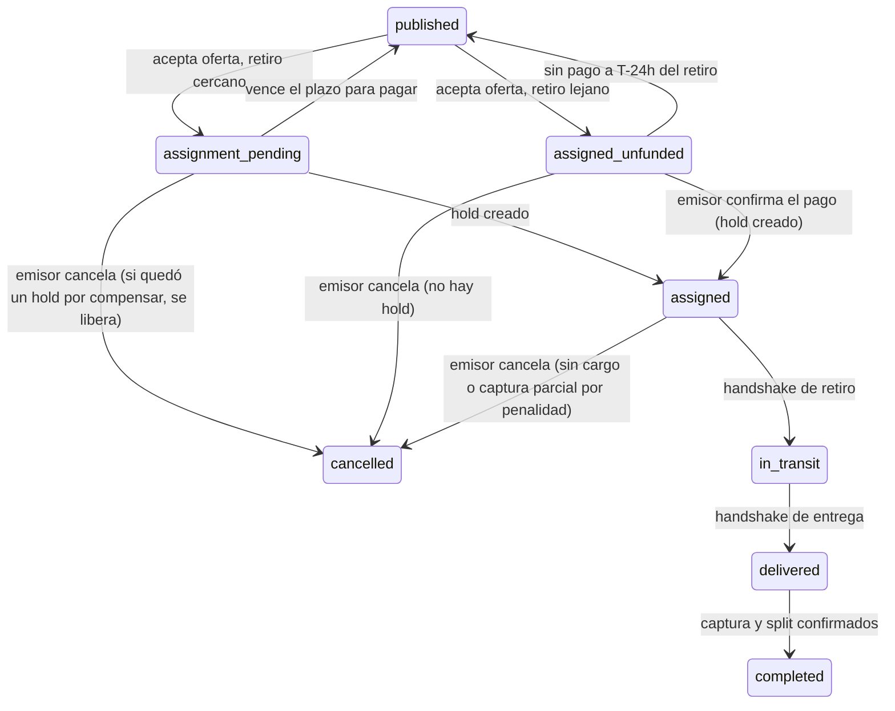

| Estado | Qué significa para el dinero |
| --- | --- |
| `assignment_pending` | Oferta aceptada, esperando que el emisor pague ahora. |
| `assigned_unfunded` | Transportista confirmado, pago todavía no pedido (retiro lejano). |
| `assigned` | Hold activo: fondos retenidos en la tarjeta del emisor, no cobrados. |
| `in_transit` | Igual que `assigned`, con el paquete en viaje. |
| `delivered` | Entregado. La captura está en curso o en reintento. |
| `completed` | Capturado: Movo y el transportista ya cobraron. Único camino: MOVO-212. |

---

## 5. Diagramas de secuencia

### 5.1 Vinculación de la cuenta de MP del transportista (MOVO-110)

Una sola vez por transportista, antes de poder ofertar (MOVO-116 lo exige).

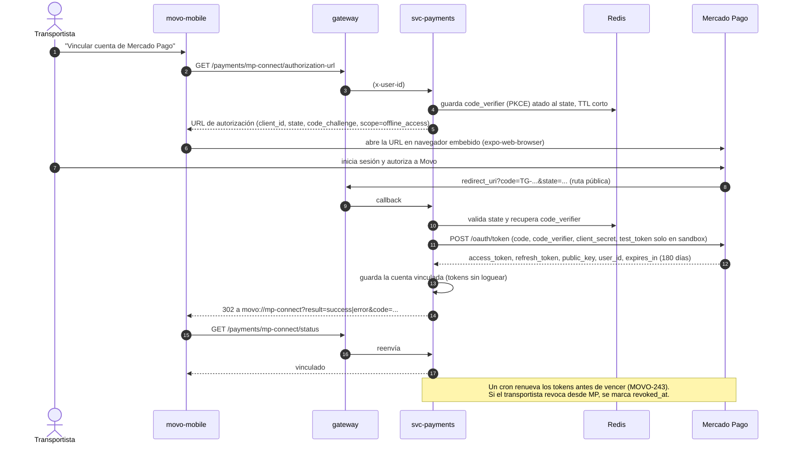

El `redirect_uri` es un callback `https` del backend (`GET /payments/mp-connect/callback`,
público en el gateway) que responde siempre un 302 al deep link, en vez de un `movo://`
directo: el canje necesita el `client_secret`, así que el backend tiene que estar en el
medio igual (MOVO-111 AC3). La app no confía en `result=success` y vuelve a consultar el
status. Desvincular (`DELETE /payments/mp-connect`) marca `unlinked_at` y borra los tokens,
y una cuenta de MP solo puede estar vinculada a un usuario de Movo a la vez.

### 5.2 Aceptación de oferta con retiro cercano (MOVO-12)

El emisor paga en el mismo flujo en que acepta la oferta.

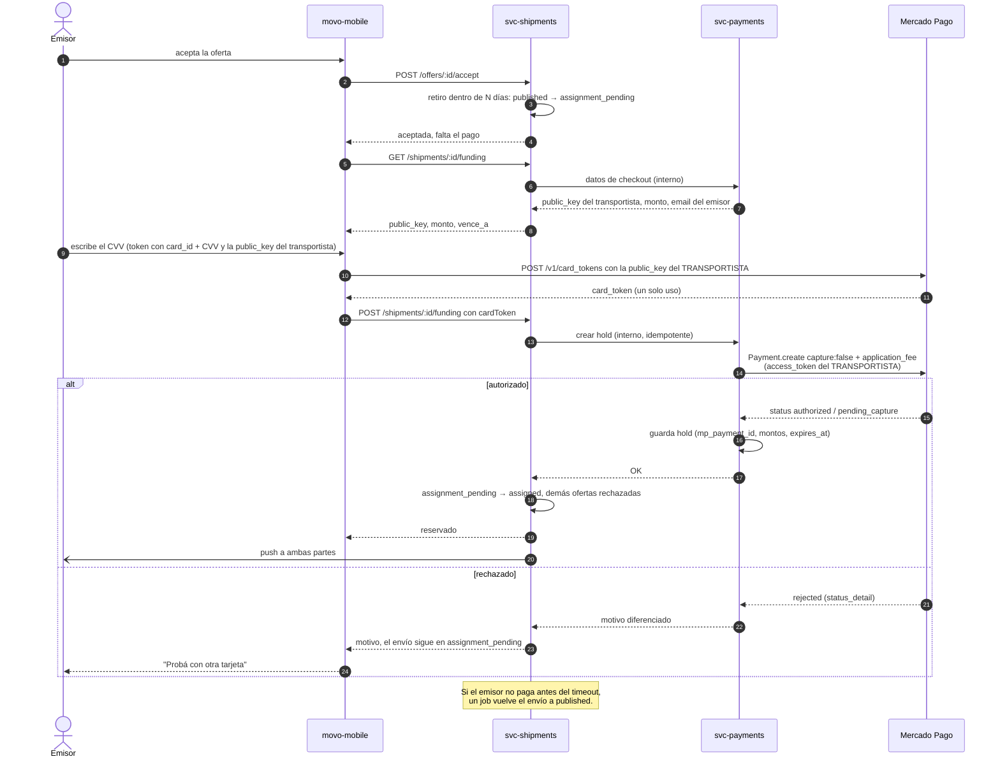

### 5.3 Retiro lejano: ventana de confirmación del pago (MOVO-210)

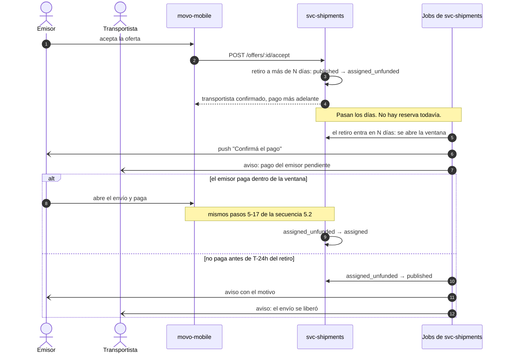

### 5.4 Entrega, captura y split (MOVO-13)

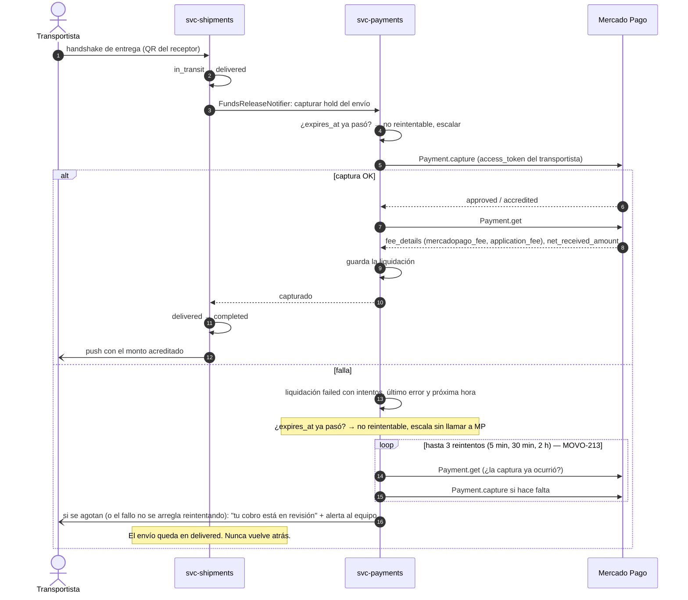

**Consulta de liquidaciones pendientes o escaladas (MOVO-213).** `GET /internal/payments/settlements?status=failed|escalated`
(interno): `failed` espera su reintento (`nextAttemptAt`), `escalated` la resuelve una persona; cada fila trae `failureReason`,
`escalationReason`, `lastError`, `attempts` y `holdExpiresAt`. Equivalente en SQL:
`SELECT * FROM payments.settlements WHERE status IN ('failed','escalated') ORDER BY updated_at DESC`. Un hold escalado por
`expires_at` pudo seguir vivo en MP (el plazo es el mínimo documentado, DD-050): conviene probar la captura a mano antes de darlo por perdido.

### 5.5 Eventos que inicia Mercado Pago (MOVO-268)

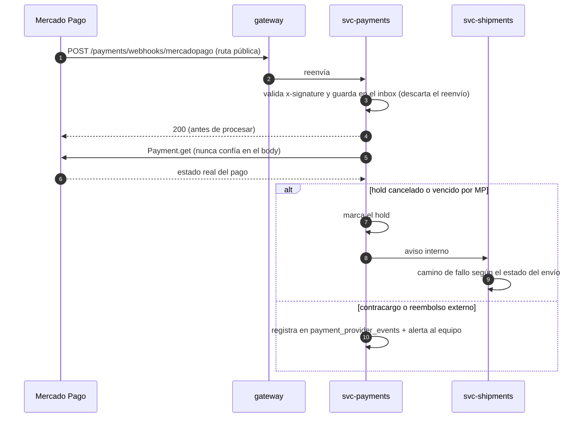

Si MP o `svc-shipments` fallan, la notificación queda pendiente en el inbox y un barrido la
reintenta con backoff hasta un tope; agotado, alerta al equipo. Un pago `approved` no cambia
el hold: la captura y su liquidación son de MOVO-212. Detalle en
`services/movo-svc-payments/CLAUDE.md` (MOVO-268).

### 5.6 Cuenta corriente del usuario (MOVO-309)

Toda deuda de una persona (penalidad de MOVO-226, comisión en efectivo de MOVO-37) se registra en
`payments.user_ledger_entries`, sin importar en qué rol se generó. Saldo con signo: positivo = debe,
negativo = a favor; cuenta todo lo que no está `voided`. Solo inserción (triggers), idempotente por
`idempotencyKey`. Cómo se salda, según el caso:

| Caso | Cómo queda | Ticket |
| --- | --- | --- |
| Cancela como **emisor** con hold propio | Deuda + `penalty_capture` negativo en la misma operación (captura parcial) | MOVO-307 |
| Cancela como **transportista** | Queda `pending`; se cobra en el próximo hold, en el rol que use primero: descuento del `application_fee` como transportista o recargo al pago como emisor (§6.1) | MOVO-311 |
| El usuario quiere saldar ya | `voluntary_payment` negativo, pagado con tarjeta guardada + CVV (5.7) | MOVO-312 |
| Error o caso especial | `manual_adjustment` de un admin, con motivo | MOVO-309 |

`svc-shipments` registra los movimientos por `POST /internal/payments/users/:userId/ledger-entries` y
consulta `GET .../balance` (`balanceArs`, `oldestUnpaidAt`, este último para el bloqueo por deuda vencida,
MOVO-313); la app lee `GET /payments/balance`. La plata de las penalidades cobradas como deuda queda para
Movo. MOVO-311 (§6.1) y MOVO-312 (5.7) ya la cobran; la captura parcial de MOVO-307 todavía no. DD-044.

### 5.7 Pagar mi saldo con tarjeta guardada + CVV (MOVO-312)

El usuario con deuda la paga él, presente y **sin salir de la app**, con el mismo flujo que un envío (Checkout API, DD-039):
tarjeta guardada + CVV, token hecho en el dispositivo. El pago va **directo a la cuenta cobradora de Movo**, sin hold, sin
`application_fee` (la plata ya es de Movo) y con captura inmediata. La cuenta cobradora es la propia cuenta de MP de Movo
S.A., configurada con sus credenciales (`MP_COLLECTOR_*`, DD-048): en producción las productivas del panel; en el sandbox el
token `TEST-` del OAuth de la cuenta de prueba, porque un token de la app sin login no puede crear pagos.

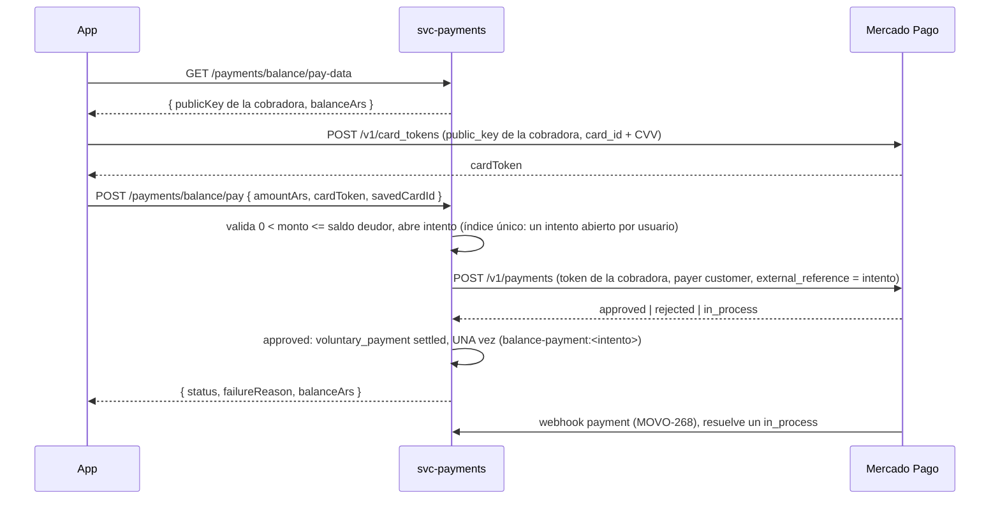

- **Idempotencia**: una fila por intento y `X-Idempotency-Key = movo-balance-<intento>`; un índice único parcial (**un intento
  abierto por usuario**, mientras `creating`/`pending`) hace que dos pedidos iguales en vuelo compartan un único pago y que lo que está en
  vuelo nunca sume más que la deuda (un pago de otro monto mientras hay uno en curso responde 409 `BALANCE_PAYMENT_IN_PROGRESS`). El movimiento del ledger se
  deduplica por `balance-payment:<intento>`, no por el estado del intento: un webhook repetido o en paralelo acredita una vez.
- **Un rechazo de la tarjeta es 200** con `status: rejected` y el motivo (`insufficient_funds`/`card_rejected`/`invalid_data`/
  `platform_error`), como en los holds. Sin respuesta de MP (502) el intento queda `creating` y el reintento reusa la key.
- **El webhook distingue estos pagos por cobrador** (`user_id` de la cuenta cobradora) y se asocia por `external_reference`;
  un pago de un transportista sigue el camino de los holds. Contracargo/reembolso: no toca el ledger, avisa al equipo.
- **Conciliación**: al pedir `pay-data` o `pay` se consulta a MP por `external_reference` de los intentos abiertos: un webhook
  perdido se acredita y un `creating` viejo sin pago en MP se descarta.

---

### 5.8 Reembolso de un pago ya capturado (MOVO-336)

Lo pide quien resuelve una disputa (MOVO-337) cuando el cobro ya está acreditado al transportista (`delivered` o
`completed`); antes de la captura no se reembolsa, el hold se libera (MOVO-209). Un solo endpoint interno,
`POST /internal/payments/settlements/by-shipment/:id/refund`, con `amountArs?` (sin monto, todo lo reembolsable),
`reason`, `idempotencyKey` del llamador y `adminId`.

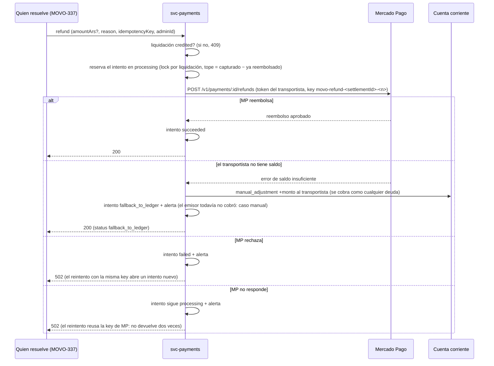

El webhook de MP (5.5) reconoce los reembolsos de esta tabla y no los alerta como externos. El reembolso confirmado
aparece en el historial de transacciones como movimiento propio. El detalle de las decisiones (por qué cada intento
tiene su propia key hacia MP, el tope, el fallback) está en `services/movo-svc-payments/HISTORIAL.md` (MOVO-336).

## 6. Cómo se reparte el dinero

Ejemplo real del sandbox (29/09/2026), envío de $1000 con comisión de Movo de 15%:

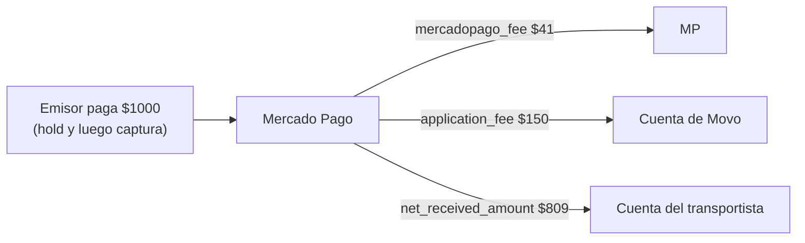

- El `application_fee` se fija **al crear el hold** y MP lo aplica **al capturar**.
  Antes de la captura el pago no muestra el split.
- Los dos fees salen de la cuenta del **cobrador** (el transportista): el emisor paga
  exactamente el precio acordado. Movo no envía `fee_payer`; es lo que MP informa en
  `fee_details` (`fee_payer: collector`). `hold.service.ts` solo manda
  `application_fee`.
- Orden de aplicación (documentación de MP para marketplaces): primero se descuenta la
  comisión de MP de los fondos del vendedor y la comisión del marketplace
  (`application_fee`) sale del saldo restante.
- Los $150 de `application_fee` se pusieron a mano en el script del spike (15% del
  total). La fórmula real (MOVO-143/209) es 15% sobre el neto del transportista:
  `application_fee = bruto - bruto / 1,15`, que para $1000 da $130,43 (~13,04% del
  bruto). Es lo que calcula `decomposeOfferGrossPrice` de `@movo/shared`.
- El 4,1% de MP es del sandbox, y es la única observación real que tenemos. En
  producción no hay un valor único que confirmar (MOVO-225): depende de las tarifas de
  MP, del medio de pago y las cuotas del emisor, y del plazo de liberación del dinero
  que cada transportista configura en su cuenta. La app muestra un estimado (4,99%,
  **a validar con pagos reales**) calculado sobre el bruto, que es sobre lo que cobra
  MP, y lo resta en todo monto que presenta como "Recibís aprox.". Mobile lee su propia
  `EXPO_PUBLIC_MP_TRANSACTION_FEE_RATE` (`movo-mobile/src/lib/commission-config.ts`);
  `MP_TRANSACTION_FEE_RATE` del backend no cambia lo que ve la app. La fórmula
  (`estimateMpFeeArs`/`estimateReceivedArs`) y el default viven en `@movo/shared`. El
  monto real de cada pago es el `mercadopago_fee` de `fee_details`.
- Si se cancela un hold, no se cobra nada a nadie.
- Con deuda en la cuenta corriente (§6.1), el emisor puede pagar más que el precio y el
  `application_fee` es mayor que la comisión de Movo.

### 6.1 Deuda de la cuenta corriente cobrada en el hold (MOVO-311)

La deuda (5.6) se cobra en el próximo hold, en el rol que el usuario use primero, sin tarjeta
ni CVV extra: sube el `application_fee`. Al crear el hold, `svc-payments` lee el saldo de las
dos partes y cobra a cada una hasta un **tope del 30% del precio** (`DEBT_COLLECTION_MAX_RATE`);
lo que no entra queda para la próxima operación.

Ejemplo con precio $1150 (comisión de Movo $150), transportista que debe $100 y emisor que debe $200:

| | Sin deuda | Transportista debe $100 | Emisor debe $200 | Los dos |
| --- | --- | --- | --- | --- |
| Paga el emisor (`transaction_amount`) | $1150 | $1150 | $1350 | $1350 |
| `application_fee` | $150 | $250 | $340,02 | $440,02 |
| Deuda saldada | — | $100 del transportista | $200 del emisor | $100 + $200 |

- **Transportista con deuda:** `application_fee` += deuda. El emisor paga lo mismo y el
  transportista recibe menos.
- **Emisor con deuda:** el monto sube en la deuda y el `application_fee` en la deuda **menos el
  estimado de la comisión de MP sobre ella** (`MP_TRANSACTION_FEE_RATE`, 4,99%: $9,98 sobre $200).
  MP cobra su comisión sobre todo el monto y la descuenta al transportista; si el fee llevara el
  recargo completo, el transportista pagaría la comisión de MP sobre la deuda del emisor. Movo la
  absorbe: el transportista recibe lo mismo que sin recargo, y al emisor se le acreditan los $200.
- **Ledger:** al crear el hold, en la misma transacción, se reserva la deuda (`fee_offset` o
  `payment_surcharge`, monto negativo, `reserved`, key `<tipo>:<holdId>`). Los dos usuarios quedan
  bloqueados (advisory lock) mientras se lee su saldo, así dos holds en paralelo no descuentan la
  misma deuda; "Pagar mi saldo" (5.7) toma el mismo lock y sus intentos abiertos descuentan del saldo
  cobrable, así un pago de saldo y un hold tampoco cobran dos veces. Mientras es solo una reserva, el saldo
  que se informa (y mide el bloqueo por deuda) no baja: recién baja al capturar (DD-044). Si el hold se rechaza, se libera o vence, un trigger de `holds` anula la reserva en la
  misma transacción y la deuda vuelve a quedar pendiente. Al capturar, la reserva pasa a `settled`
  por lo que retuvo MP (`fee_details`); si retuvo menos, se anula y se asienta lo real.
- **Liquidación:** `commission_ars` es solo la comisión de Movo; la deuda cobrada va en
  `debt_offset_ars` y `debt_surcharge_ars`. `GET /shipments/:id/settlement` le muestra a cada parte
  su deuda saldada (`debtCollectedArs`). El transportista ve su cobro **sin el recargo del emisor**:
  bruto $1150 y fee de MP sin lo que MP cobró sobre el recargo (`carrierPaymentView`), así no ve la
  deuda ajena y `bruto − fee MP − comisión − su deuda = neto`.
- **Antes de comprometerse:** el emisor ve `{ priceArs, pendingBalanceArs, totalArs }` en
  `GET /shipments/:id/funding` y paga mandando `expectedTotalArs = totalArs`: si su deuda cambió en el medio,
  409 `HOLD_AMOUNT_CHANGED` en vez de cobrarle de más; el transportista, el descuento (`debtDiscount`) en sus ofertas
  `pending` y en el detalle del envío asignado.
- **Reintegro o contracargo:** hoy no repone la deuda cobrada (limitación aceptada, DD-044).
- **Límite de MP** (spike MOVO-305): el fee tiene que ser `< transaction_amount` (si no, `400 4038`).
  Con el tope de 30% el fee llega a ~73% del precio y el monto a 130%; la env var acepta hasta 0,5.
- **Penalidad (MOVO-307):** en una captura parcial el `application_fee` se cobra entero, y capturar
  un monto ≤ al fee da `4201`. Un hold con deuda en el fee deja menos margen para cobrar una
  penalidad por captura parcial; si no alcanza, se aplica el plan B de MOVO-307.

---

## 7. Decisiones de diseño y por qué

| Decisión | Motivo | Dónde |
| --- | --- | --- |
| Marketplace de MP: Payments API + OAuth del transportista + `application_fee` | Movo nunca toca el dinero del transportista: MP lo acredita directo en su cuenta y retiene la comisión de Movo en la misma operación. | MOVO-209, ADR-022 (`docs/payments/adr-022-arquitectura-de-cobro.md`) |
| La tarjeta se tokeniza con la `public_key` **del transportista** | Requisito de MP: el card_token tiene que pertenecer a la cuenta que cobra. Con otra key, error 2006. | Spike MOVO-49 |
| El hold se crea **siempre con el emisor presente**, que escribe solo el CVV | Sin CVV MP no crea el hold (500 / `3031`), así que el cobro automático sin el emisor sigue descartado. Con tarjeta guardada + CVV sí funciona (13/10/2026, DD-039 propuesto). | MOVO-12, MOVO-65, SOLUCION-FINAL §7 |
| La tarjeta se guarda en un customer de la **cuenta de Movo**, no en la del transportista | Una sola tarjeta sirve para pagar a cualquier transportista: el mobile pide el token con `card_id` + CVV y la `public_key` del transportista del envío. El `payer` del hold tiene que ser ese customer (con `payer: {email}`, error `2002`). | DD-039, MOVO-100, MOVO-282 |
| El hold con tarjeta guardada lleva `payer: { type: "customer", id }` y `saved_card_id`; sin tarjeta guardada, `payer: { email }` | El hold (`POST /internal/payments/holds`) recibe `payerUserId` + `savedCardId?`: `svc-payments` valida que la tarjeta sea de ese emisor y esté viva (si no, `404` sin revelar si existe) y resuelve el customer; guarda `saved_card_id` en el hold, que habilita el `409 CARD_IN_USE` al borrar la tarjeta. `savedCardId` entra en el `request_fingerprint`. Un CVV incorrecto no es un error HTTP: vuelve como hold `rejected`/`invalid_data`. | MOVO-282 |
| El token de Movo para customers se pide con `client_credentials` + `test_token=true` | Con el `APP_USR-` de la app MP responde `401 300 "live credentials"` en sandbox. | DD-039, MOVO-100 |
| El hold se ancla **cerca del retiro**, no en la aceptación | MP cancela el hold a los pocos días. Si falla cerca del retiro, falla antes de la custodia, cuando todavía se puede republicar el envío. | MOVO-12 |
| **No** se renuevan holds vencidos | La renovación puede fallar con el paquete en tránsito, bloquea doble monto y parece un doble cobro. | MOVO-12 |
| `svc-shipments` es el dueño de la saga y la puerta del mobile | Los estados del envío viven ahí. `svc-payments` queda aislado como único integrador de MP. | MOVO-210 |
| SDK oficial `mercadopago` v3 para pagos; canje y refresh de OAuth con `fetch` propio | Mismo resultado que la API REST, con tipos, idempotencia y errores ya resueltos. El canje queda afuera porque el SDK no tipa `code_verifier`/`test_token` y exige un access token que `/oauth/token` no necesita. | MOVO-267, SOLUCION-FINAL §4 |
| Las deudas (penalidades, comisión en efectivo) viven en una **cuenta corriente del usuario**, no del transportista | La misma persona es emisor y transportista: una penalidad generada en un rol se puede saldar en el otro. Saldo con signo, solo inserción, idempotente. Se cobra con MOVO-311 (`application_fee` del próximo hold, §6.1) y 312 (pago voluntario); la captura parcial de MOVO-307 falta. | MOVO-309, DD-044 (`docs/payments/dd-044-cuenta-corriente-del-usuario.md`) |
| La penalidad por cancelar un `assigned` se cobra con una **captura parcial del hold**, y si no se puede queda como deuda | El emisor ya tiene el hold autorizado: cobrar en el momento evita una deuda que puede no cobrarse. MP cobra la comisión entera en la captura parcial (el transportista recibe ≈ 11 % del precio) y rechaza capturar menos que la comisión: en ese caso se libera el hold y la penalidad queda en la cuenta corriente. | MOVO-306, MOVO-307, DD-047 (`docs/payments/dd-047-penalidad-de-cancelacion.md`) |
| Idempotencia en hold, captura, saga y webhook | Un doble hold retiene plata dos veces; una doble captura cobra dos veces. | MOVO-209, 210, 212, 268 |

**Costo aceptado de la ruta lejana:** el transportista se compromete sin fondos
reservados y sin validación previa de la tarjeta del emisor. Si el emisor no confirma, el
envío se republica. Se mitiga con recordatorios y aviso explícito al transportista.

---

## 8. Pasos del flujo → tickets de Linear

| Paso | Backend | Mobile | Historia |
| --- | --- | --- | --- |
| Base de `svc-payments` (Prisma, SDK, env vars, gateway) | MOVO-267 | — | — |
| Vincular la cuenta de MP del transportista | MOVO-111 | MOVO-112 | MOVO-110 |
| Renovar tokens OAuth automáticamente | MOVO-243 | — | MOVO-110 |
| Exigir licencia + MP para ofertar o declarar viaje | MOVO-116 | MOVO-117 | MOVO-110 (AC6) |
| Plazo real del hold y valor de N | MOVO-215 (spike) | — | MOVO-12 |
| Crear, consultar y liberar el hold | MOVO-209 | — | MOVO-12 |
| Saga: rutas, ventana de confirmación, timeouts, cancelación | MOVO-210 | — | MOVO-12 |
| Guardar y administrar tarjetas del emisor | MOVO-100 | MOVO-101 | MOVO-65 |
| Hold con tarjeta guardada (pagador = customer) | MOVO-282 | — | MOVO-65 |
| Pagar con tarjeta guardada + CVV (aceptación o confirmación) | — | MOVO-269 | MOVO-12 |
| Validar con otro transportista, en producción y el débito sin CVV | MOVO-283 (spike) | — | MOVO-65 |
| Estado de la reserva en el detalle del envío | — | MOVO-211 | MOVO-12 |
| Webhook de MP (holds vencidos, contracargos) | MOVO-268 | — | MOVO-12 |
| Captura y split al entregar | MOVO-212 | — | MOVO-13 |
| Reintentos y escalado manual | MOVO-213 | — | MOVO-13 |
| Captura parcial del hold por penalidad | MOVO-306 | — | MOVO-226 |
| Cancelación del emisor desde `assigned` con penalidad | MOVO-307 | MOVO-308 | MOVO-226 |
| Detalle del cobro (bruto, comisión, neto) | — | MOVO-214 | MOVO-13 |

**En Backlog, fuera del camino crítico:**

| Ticket | Por qué está en espera |
| --- | --- |
| MOVO-37 | Pago en efectivo: Movo le cobra la comisión a una tarjeta guardada del transportista. Usa las tarjetas de MOVO-65/100/101, pero el débito sin CVV no está validado (MOVO-283). |
| MOVO-28 | Historial de transacciones del emisor. Depende de que existan liquidaciones (MOVO-212). |

---

## 9. Orden de implementación

Las flechas son dependencias ("A → B": B necesita a A). Verde: backend; azul: mobile;
amarillo: spike.

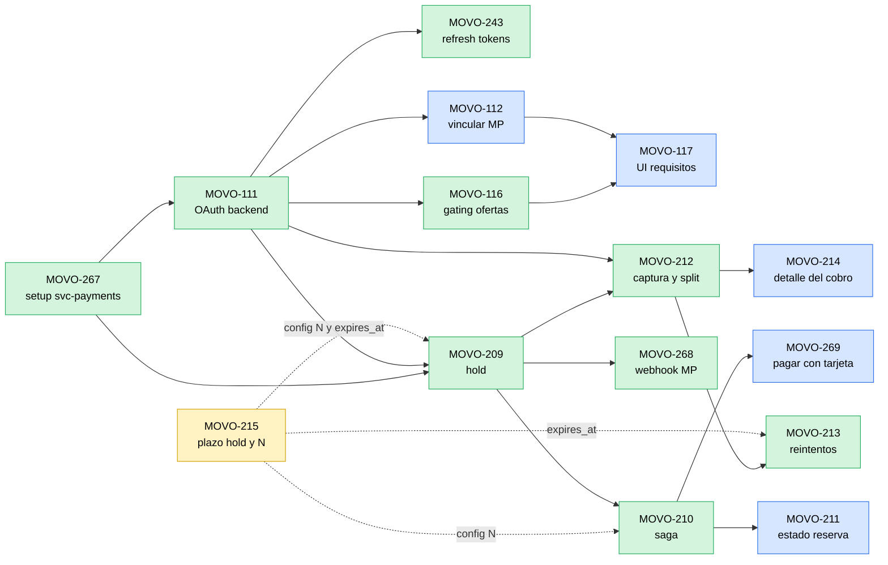

### Fases sugeridas

| Fase | Backend | Mobile | Qué se puede demostrar al terminar |
| --- | --- | --- | --- |
| **0. Arranque** (en paralelo) | MOVO-267 | — | `svc-payments` desplegado y ruteado por el gateway. |
| | MOVO-215 (spike, corre en paralelo; la medición tarda días) | | |
| **1. Cuenta del transportista** | MOVO-111 | MOVO-112 (contra el contrato de 111) | Un transportista vincula su cuenta de MP desde la app. |
| **2. Reserva de fondos** | MOVO-209 → MOVO-210 | MOVO-269, MOVO-211 (contra el contrato de 210) | Aceptar una oferta, pagar y llegar a `assigned`: **se destraba el retiro real**, que hoy no tiene camino sin el devkit. |
| **3. Cobro** | MOVO-212 → MOVO-213 | MOVO-214 | Entregar y ver el split acreditado: flujo económico completo. |
| **4. Robustez y requisitos** | MOVO-268, MOVO-243, MOVO-116 | MOVO-117 | Vencimientos informados por MP, tokens que se renuevan solos y ofertas bloqueadas sin MP. |

Notas sobre el orden:

- **La fase 2 es el camino crítico de la demo.** Hoy ningún código lleva un envío de
  `assignment_pending` a `assigned`, y el handshake de retiro exige `assigned`.
- **Mobile arranca contra el contrato**, no contra el endpoint terminado: acordar rutas,
  payloads y códigos de error al inicio de cada par backend/mobile (mismo criterio que
  MOVO-100/101).
- MOVO-215 no bloquea el código: N y el plazo del hold son **configuración**. Se puede
  implementar con un valor provisorio (por ejemplo 5 días) y ajustarlo cuando termine
  la medición.
- MOVO-116 bloquea la creación de ofertas sin MP vinculado. Conviene activarlo recién
  cuando MOVO-112 esté en la app, para no dejar a los transportistas sin forma de
  cumplir el requisito.

---

## 10. Preguntas abiertas

| Pregunta | Dónde se resuelve |
| --- | --- |
| Plazo real del hold en Argentina y valor de N | MOVO-215 |
| ¿Cómo se embebe el formulario de tarjeta de MP en React Native, y acepta las cuentas de prueba? | MOVO-269 |
| ¿Producción exige homologar el modelo Marketplace en la cuenta real de Movo? | Hilo de soporte de MP (pregunta 3) |
| ¿Por qué el pagador figura con `payer.id 3612507366` y no con el ID del panel? | Hilo de soporte de MP |
